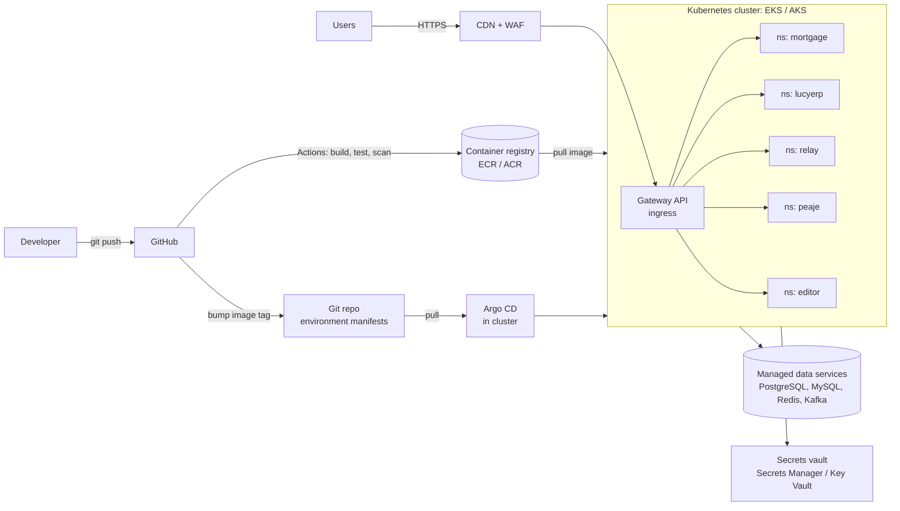

# Moving my apps to containers on AWS and Azure

Migration playbooks for the applications published on my [portfolio](https://lucianandreinegoita.dev/). Each playbook takes one app from where it runs today (a laptop, a clinic PC, a Docker Compose stack) to a containerised deployment on Kubernetes, with the AWS and the Azure version side by side.

| App | Runs today on | Playbook |
|---|---|---|
| Mortgage Analyst | Spring Boot JAR + PostgreSQL (Docker locally) | [mortgage-analyst.md](apps/mortgage-analyst.md) |
| LucyERP | Next.js standalone + SQLite on a Windows PC | [lucyerp.md](apps/lucyerp.md) |
| Relay Traffic Copilot | Python process with six threads + SQLite on a Windows PC | [relay-copilot.md](apps/relay-copilot.md) |
| peaje | Single Go binary + SQLite | [peaje.md](apps/peaje.md) |
| Real-time collaborative editor (thesis) | Docker Compose: Moodle, MariaDB, Kafka, Hocuspocus | [collaborative-editor.md](apps/collaborative-editor.md) |

The shared platform each app lands on is described once per cloud:

- [AWS platform: EKS landing zone](platform-aws.md)
- [Azure platform: AKS landing zone](platform-azure.md)
- [Reference manifests](examples/mortgage-analyst/) (Kustomize, for the Mortgage Analyst)

## Target shape

All five apps share one cluster per environment, one namespace per app. The cluster is the expensive part, so it is amortised across workloads, and the platform concerns (ingress, certificates, secrets, observability, GitOps) are solved once.

## Principles applied to every app

1. **Twelve-factor first.** Configuration from environment variables, logs to stdout, no state on the container filesystem. Most of the work in each playbook is here, not in the YAML.
2. **State goes to managed services.** Databases, caches and brokers are managed (RDS, Azure Database, MSK, Event Hubs). Running a database in the cluster is only accepted for a single-writer component with no HA requirement, and it is called out when it happens.
3. **No secret in an image, a manifest or a repo.** Secrets live in AWS Secrets Manager or Azure Key Vault and reach pods through the External Secrets Operator. Pods authenticate to the cloud with workload identity (EKS Pod Identity, Entra Workload ID), never with static keys.
4. **GitOps for deployment.** CI builds and pushes an immutable image tagged with the commit SHA. Argo CD reconciles the cluster from Git. Nobody runs `kubectl apply` against production.
5. **Gateway API for ingress.** The community ingress-nginx controller stopped receiving releases and security fixes in March 2026, so new clusters use Gateway API with the cloud's own controller (AWS Load Balancer Controller, Application Gateway for Containers).
6. **Scheduled work is a CronJob.** In-process schedulers run once per replica. Anything periodic moves to a Kubernetes CronJob, or takes a distributed lock.

## Service mapping

| Concern | AWS | Azure |
|---|---|---|
| Kubernetes | EKS (Auto Mode or managed node groups with Karpenter) | AKS (Automatic or Standard with node autoprovisioning) |
| Lighter container option | ECS on Fargate | Azure Container Apps |
| Image registry | ECR | Azure Container Registry |
| Ingress | AWS Load Balancer Controller (ALB) via Gateway API | Application Gateway for Containers via Gateway API |
| Edge, CDN, WAF | CloudFront + AWS WAF | Azure Front Door Premium (WAF included) |
| DNS and certificates | Route 53 + ACM | Azure DNS + Front Door managed certificates |
| PostgreSQL | RDS for PostgreSQL / Aurora PostgreSQL | Azure Database for PostgreSQL Flexible Server |
| MySQL / MariaDB | RDS for MariaDB or MySQL | Azure Database for MySQL Flexible Server |
| Redis | ElastiCache (Valkey or Redis OSS) | Azure Managed Redis |
| Kafka | Amazon MSK (provisioned or Serverless) | Event Hubs, Kafka endpoint (Standard tier or higher) |
| Shared file storage | EFS (EFS CSI driver) | Azure Files (Azure Files CSI driver) |
| Object storage | S3 | Blob Storage |
| Secrets | Secrets Manager + External Secrets Operator | Key Vault + External Secrets Operator |
| Pod identity | EKS Pod Identity | Microsoft Entra Workload ID |
| Metrics and logs | CloudWatch Container Insights, Amazon Managed Prometheus, Managed Grafana | Azure Monitor (Container Insights, managed Prometheus), Azure Managed Grafana |
| Infrastructure as code | Terraform | Terraform |

## When Kubernetes is not the right call

Kubernetes is the target because a shared cluster pays off with five apps and because it keeps the two clouds symmetric. For a single small app the cheaper answer is a serverless container platform: ECS on Fargate on AWS, Azure Container Apps on Azure. Every playbook keeps its containers portable to those platforms, so the decision can be revisited without touching the app. AWS App Runner is left out on purpose: AWS has closed it to new customers.

## Sources

- [Ingress NGINX retirement (Kubernetes blog)](https://kubernetes.io/blog/2025/11/11/ingress-nginx-retirement/)
- [AWS App Runner availability change](https://docs.aws.amazon.com/apprunner/latest/dg/apprunner-availability-change.html)
- [Azure Event Hubs for Apache Kafka](https://learn.microsoft.com/en-us/azure/event-hubs/azure-event-hubs-apache-kafka-overview)
