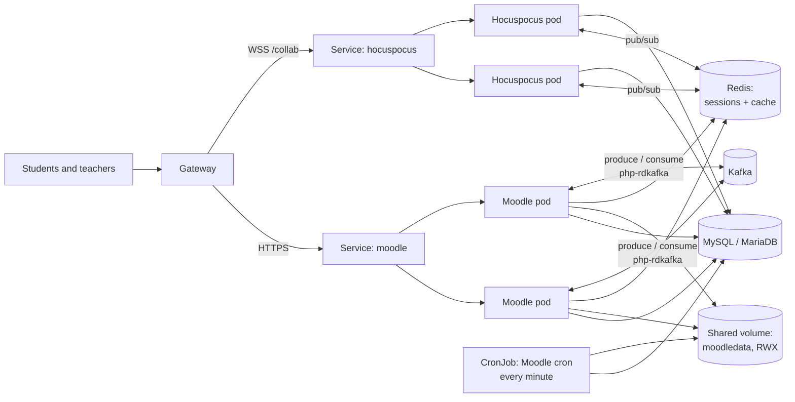
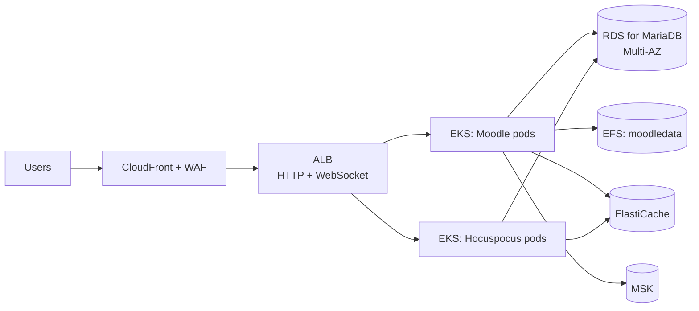
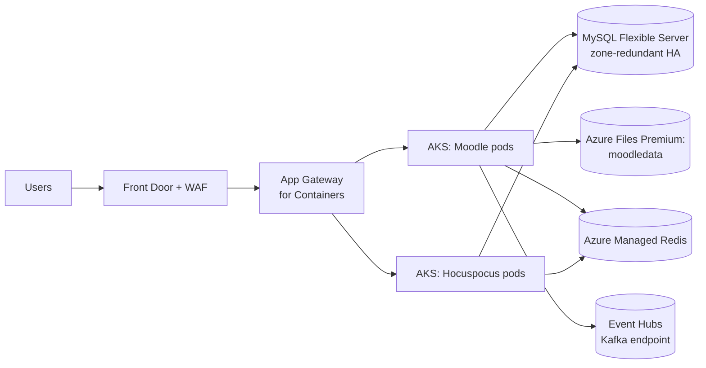

# Real-time collaborative editor (thesis) on AWS and Azure

Code: private repository (final degree project, UCLM).

## Today

A Docker Compose stack:

| Service | Role |
|---|---|
| `moodle` | Moodle (PHP) with the Kafka Integration plugin that embeds the editor in a course |
| `mariadb` | Moodle's database |
| `hocuspocus` | Node.js WebSocket server that syncs edits as Yjs CRDT updates, documents persisted to a local volume |
| `zookeeper` + `kafka` | Event bus: the Moodle plugin produces and consumes collaboration events through `php-rdkafka` |
| `selenium-hub` + `chrome-node` | End-to-end tests with up to 10 simultaneous users |

Three parts hold state: Moodle's database, Moodle's data directory (`moodledata`, uploaded files and caches) and Hocuspocus documents.

## Changes before containerising

| Change | Why |
|---|---|
| Hocuspocus authentication | `onAuthenticate` accepts every connection today. In the cloud it must validate a short-lived token issued by the Moodle plugin for that user and course. |
| Hocuspocus persistence out of the container | Documents go to the database through `@hocuspocus/extension-database` (or to object storage), not to a local volume. |
| Hocuspocus Redis extension | With more than one replica, `@hocuspocus/extension-redis` relays updates between instances, so two users on different pods see each other. |
| Moodle sessions and cache in Redis | Moodle supports Redis as session handler and as MUC cache store. Without it, sessions are tied to one pod. |
| `moodledata` on shared storage | Every Moodle replica needs the same data directory. |
| Moodle cron as a `CronJob` | `admin/cli/cron.php` every minute, outside the web pods. |
| Kafka without ZooKeeper | Managed Kafka (MSK) runs in KRaft mode, and Event Hubs has no ZooKeeper at all. The plugin only produces and consumes, so it is unaffected. |
| Selenium out of the runtime | The E2E suite runs in CI against a `dev` environment, not as part of the production stack. |

## Kubernetes topology

WebSocket connections are long-lived. The gateway route for `/collab` needs an idle timeout of several minutes, and Hocuspocus replicas need a `preStop` delay so connected clients reconnect cleanly during rollouts.

## AWS

- **Database:** RDS for MariaDB keeps the engine unchanged. Aurora MySQL is an option if Moodle's MySQL support is preferred.
- **moodledata:** EFS through the EFS CSI driver, `ReadWriteMany`. Moodle's local cache directory (`localcachedir`) stays on each pod's ephemeral disk, because EFS latency hurts it.
- **Kafka:** Amazon MSK provisioned on small brokers, with SASL/SCRAM credentials stored in Secrets Manager. MSK Serverless only accepts IAM authentication, and the plugin talks to Kafka through `php-rdkafka`, which has no MSK IAM signer, so SCRAM on provisioned MSK is the path that needs no code change.
- **WebSockets:** the ALB supports them natively. Its idle timeout is raised so idle editors are not dropped.

## Azure

- **Database:** Azure Database for MySQL Flexible Server. Azure Database for MariaDB has been retired, so this is the managed target. Moodle supports MySQL directly.
- **moodledata:** Azure Files Premium (NFS) through the Azure Files CSI driver.
- **Kafka:** Event Hubs Standard or Premium with the Kafka endpoint. The plugin's `php-rdkafka` configuration points at `<namespace>.servicebus.windows.net:9093` with SASL PLAIN and the connection string from Key Vault. Each Kafka topic becomes an event hub.
- **WebSockets:** Front Door and Application Gateway for Containers both support WebSocket traffic.

## Data migration

1. Put Moodle in maintenance mode.
2. Dump MariaDB (`mariadb-dump --single-transaction`) and import into the managed database.
3. Copy `moodledata` to EFS or Azure Files (`rsync` from a temporary pod that mounts both).
4. Export Hocuspocus documents from the local volume and load them through the database extension.
5. Run Moodle's upgrade CLI, purge caches, leave maintenance mode, run the Selenium suite against the new environment.

## Risks and open points

- **Moodle on Kubernetes is the heavy part.** It expects a shared filesystem and a single cron runner. Both are solved above, but they add latency and cost that a single VM would not have. For a course-sized deployment, one VM for Moodle plus the managed database is a legitimate alternative, with only Hocuspocus and Kafka on the cluster.
- **Event Hubs is Kafka-compatible, not Kafka.** Producers and consumers work as they are. Admin operations go through Azure instead of Kafka tools.
- **Security of the editor channel.** Until the token check in `onAuthenticate` exists, the WebSocket endpoint must not be public.
