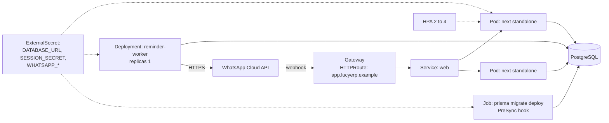
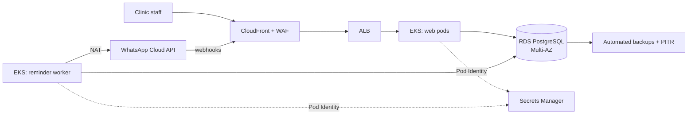
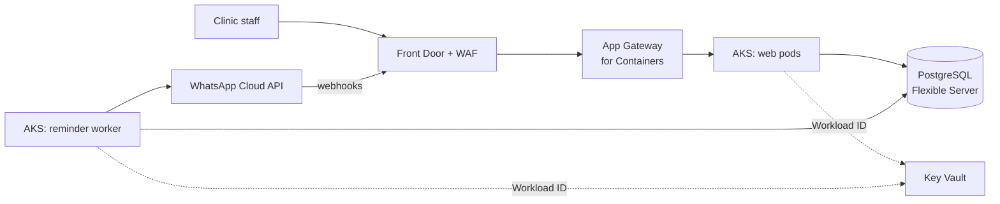

# LucyERP on AWS and Azure

Code: [KORA-Digital-Solutions/lucyERP](https://github.com/KORA-Digital-Solutions/lucyERP)

## Today

- Next.js 16 (App Router, `output: "standalone"`) with React 19 and Prisma.
- One SQLite file on the clinic's Windows PC, installed as a Windows service with scheduled backups.
- A second Node process (`node-cron`) that sends appointment reminders through the WhatsApp Business Cloud API.
- Every table already carries `clinicId`, which was put there to make a multi-tenant version possible.

On-premise is a deliberate choice for a single clinic. The cloud version only makes sense as **one deployment serving many clinics**, and that is what this playbook designs.

## Changes before containerising

| Change | Why |
|---|---|
| Switch the Prisma datasource from SQLite to PostgreSQL | SQLite is a single file with a single writer. Several replicas need a shared database. Prisma supports PostgreSQL natively. The fields that are `String` in SQLite because it lacks enums can become real PostgreSQL enums. |
| Enforce tenancy on every query | Today `clinicId` is a column. In a shared database it becomes a security boundary: a Prisma client extension that injects `clinicId` from the session, plus PostgreSQL row-level security as a second line of defence. |
| Run `prisma migrate deploy` as a pre-deploy Job | Today it runs in `predev`. In the cluster it runs once per release, before the new pods start. |
| Split the reminder worker into its own Deployment (or a CronJob) | Same image, different command. It scales and fails independently of the web tier, and only one replica must send reminders, so it runs with `replicas: 1` or as a CronJob every few minutes. |
| Move `SESSION_SECRET` and the `WHATSAPP_*` credentials to the vault | They are in `.env` today. |
| Expose the existing webhook route publicly | `/api/webhooks/whatsapp` already validates the Meta signature with `WHATSAPP_APP_SECRET`. On a clinic PC it can't receive callbacks. In the cloud it gets a public route through the gateway, so delivery and read receipts start working. |

## Kubernetes topology

## AWS

- **Static assets:** the standalone build serves `.next/static` itself. CloudFront caches `/_next/static/*` with a long TTL, so pods only serve dynamic requests.
- **Database:** RDS for PostgreSQL. A small Graviton instance is enough for dozens of clinics at the expected volume. Multi-AZ in prod.
- **Backups:** the `copia-seguridad.cmd` script disappears. RDS automated backups with point-in-time recovery replace it, plus a monthly snapshot copied to a second region.

## Azure

- **Static assets:** Front Door caching rule on `/_next/static/*`.
- **Database:** Azure Database for PostgreSQL Flexible Server, General Purpose with zone-redundant HA in prod.

## Data migration (per clinic)

Each existing clinic has its own SQLite file. Moving one clinic:

1. Stop the Windows service and take a final copy of the `.db` file.
2. Run a one-off migration Job that reads the SQLite file (uploaded to S3 or Blob Storage) and writes into PostgreSQL with the clinic's new `clinicId`. Prisma can't read and write two providers from one client, so the Job uses two generated clients or `pgloader`.
3. Compare row counts per table and spot-check appointments for the next two weeks.
4. Point the clinic's browser shortcut to the cloud URL.

## Risks and open points

- **Connectivity becomes a dependency.** The on-premise version works without internet. A clinic with an unreliable connection loses its agenda when the line drops. Keep the on-premise package available for those clinics.
- **Personal data.** Client records are personal data under GDPR. The database and backups must stay in an EU region (`eu-west-3` Paris or `eu-south-2` Spain on AWS, `Spain Central` or `West Europe` on Azure), and each clinic needs a data processing agreement.
- **Cost floor.** For fewer than about five clinics, Kubernetes is overkill. ECS on Fargate or Azure Container Apps with the same image and a managed PostgreSQL is the cheaper start.
