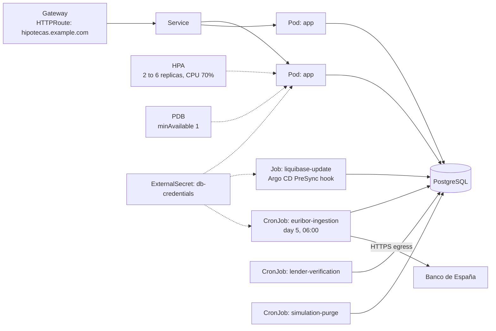
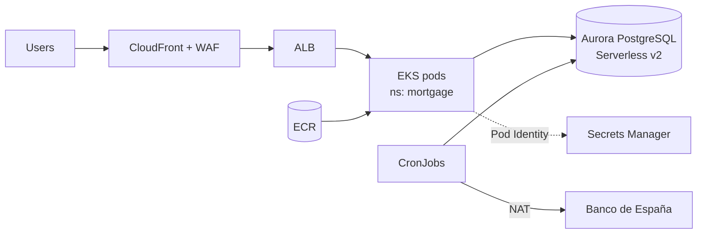
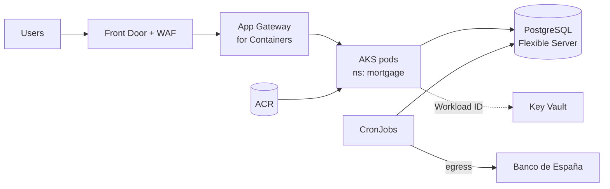

# Mortgage Analyst on AWS and Azure

Code: [Lux-source/analista_hipotecas](https://github.com/Lux-source/analista_hipotecas)

## Today

- One Spring Boot 3 JAR (Java 17) that serves the Angular bundle and the REST API on the same port.
- PostgreSQL 16 with the schema managed by Liquibase.
- Three in-process `@Scheduled` jobs: monthly Euribor ingestion from Banco de España, lender verification and a purge of old simulations.
- Datasource credentials already come from `SPRING_DATASOURCE_*` environment variables, and `$PORT` is honoured. The Dockerfile exists.

This is the app closest to cloud-ready. The work is in the scheduled jobs and in how Liquibase runs.

## Changes before containerising

| Change | Why |
|---|---|
| Expose Actuator `liveness` and `readiness` health groups | Kubernetes needs to tell "process alive" from "can serve traffic" (database reachable). |
| Run Liquibase as a pre-deploy Job, not at app start | With two or more replicas starting together, the Liquibase lock table serialises them, but a failed migration should block the rollout instead of crash-looping pods. |
| Move the three jobs out of the request path | `@Scheduled` fires once per replica. Option A: run each job as a Kubernetes `CronJob` with the same image and a Spring profile that only runs that job. Option B: keep them in-process and add ShedLock on PostgreSQL. A is preferred: job failures become visible as failed Kubernetes Jobs. |
| JSON logs to stdout | Container Insights and Azure Monitor parse them without custom parsers. |
| Graceful shutdown (`server.shutdown=graceful`) | Lets in-flight requests finish during rolling updates. |

## Kubernetes topology

Reference manifests for this topology are in [examples/mortgage-analyst](../examples/mortgage-analyst/).

## AWS

- **Database:** Aurora PostgreSQL Serverless v2 for dev and low traffic, since it scales capacity with load. RDS for PostgreSQL Multi-AZ in prod if a fixed-size instance is cheaper for the steady load.
- **Credentials:** RDS-managed master password in Secrets Manager, plus an app user created by a Liquibase changeset. The External Secrets Operator syncs it to `db-credentials`.
- **Egress:** the ingestion CronJob is the only workload that calls out to the internet. A dedicated NAT route or an egress `NetworkPolicy` allowing only the Banco de España host keeps it that way.

## Azure

- **Database:** Azure Database for PostgreSQL Flexible Server, Burstable tier for dev, General Purpose with zone-redundant HA for prod, private endpoint only.
- **Credentials:** Microsoft Entra authentication for PostgreSQL removes the database password entirely: the pod's workload identity requests a token and uses it as the password. The PostgreSQL JDBC driver supports this through the Azure Identity extensions for JDBC.

## Data migration

The catalogue is seeded by Liquibase changesets, so a fresh environment needs no data copy. To carry over user simulations from an existing database: `pg_dump --format=custom` from the source, `pg_restore` into the managed instance before the first deploy, then let Liquibase confirm the changelog is in sync.

## Rollout

1. Build and push the image from CI, tagged with the commit SHA.
2. Provision the database with Terraform, create the secret.
3. Deploy to `dev` through Argo CD: the PreSync Job runs Liquibase, then the Deployment rolls out.
4. Trigger each CronJob manually once (`kubectl create job --from=cronjob/...`) and check the result.
5. Promote to `prod` with a pull request on the GitOps repo.

## Risks and open points

- The SCD2 partial indexes key on the literal end-of-time sentinel. `hibernate.jdbc.time_zone` must stay unset (the reason is documented in `application.yml`). Container images default the JVM to UTC while development ran on Europe/Madrid, so set `TZ` explicitly in the Deployment and keep the Testcontainers suite running against the same image.
- Testcontainers integration tests need Docker in CI. GitHub-hosted runners provide it. Self-hosted runners inside the cluster would need a rootless alternative.
