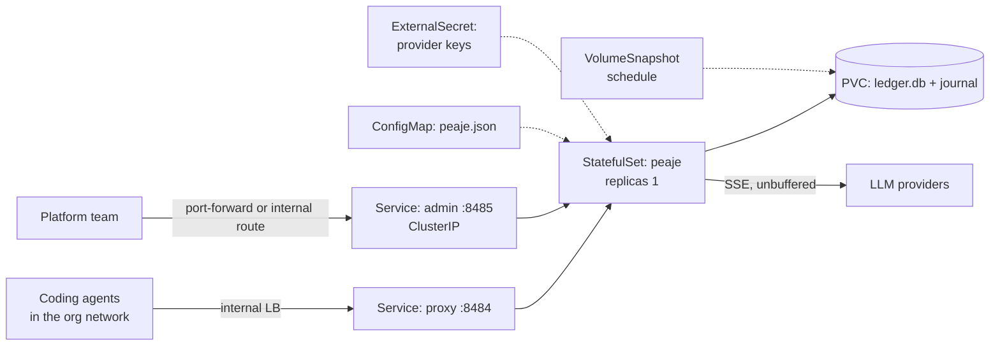
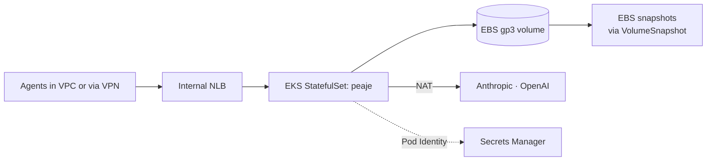
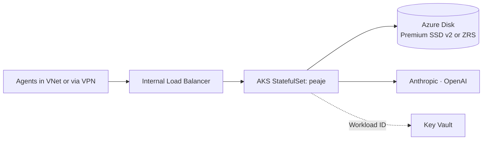

# peaje on AWS and Azure

Code: [Lux-source/peaje](https://github.com/Lux-source/peaje) (early scaffold, the ledger hot path is in progress)

## Today

- One static Go binary with zero dependencies outside the standard library. Two listeners: the proxy (`:8484`) and the admin API (`127.0.0.1:8485`).
- One JSON config file. SQLite ledger with a crash-safe journal.
- The core invariant, `spent + held ≤ budget` at every instant, relies on reserve and settle being serialised through **one writer**.

That last point decides the whole deployment: peaje cannot simply be scaled out behind a load balancer.

## Two deployment shapes

**Shape A: single writer (matches v0).** One replica, SQLite on a persistent volume. Simple and correct. Availability is that of one pod: during a restart, requests fail according to the configured `fail_mode`.

**Shape B: horizontally scaled (future).** Several stateless proxy replicas and the ledger in PostgreSQL, with reservations taken inside a transaction (`SELECT ... FOR UPDATE` on the key's budget row, or an atomic conditional `UPDATE ... WHERE spent + held + :amount <= budget`). This needs a second ledger implementation behind the same interface and an ADR, because it changes the latency budget of every request.

Shape A is the recommendation until a single replica is the bottleneck.

## Changes before containerising

| Change | Why |
|---|---|
| Config path and listen addresses from flags or env | The JSON file is mounted from a ConfigMap. Provider API keys referenced in it come from a Secret, never inline. |
| Admin listener on `0.0.0.0` inside the pod, exposed only through a ClusterIP Service | `127.0.0.1` would make it unreachable from other pods. A NetworkPolicy restricts who can reach it. |
| `/healthz` as readiness and liveness | Already implemented. |
| Distroless or `scratch` image, non-root, read-only root filesystem | A static binary needs nothing else. The only writable path is the volume. |
| `SIGTERM` handling that stops admitting, drains streams, then settles | Rolling restarts must not leave reservations unsettled. The journal covers crashes, this covers planned restarts. |

## Kubernetes topology (Shape A)

It runs as a `StatefulSet` with one replica so the volume follows the pod. A StatefulSet never runs two pods with the same identity, and the volume is `ReadWriteOnce`, so the old pod is terminated before the new one opens the ledger.

## AWS

- **Exposure:** an internal Network Load Balancer, not the public ALB. peaje is an internal platform service that sits between the organisation's agents and the providers.
- **Streaming:** NLB passes TCP through, so SSE streams are not buffered or cut by idle timeouts shorter than a long completion. If an ALB is used instead, raise its idle timeout above the longest expected stream.
- **Storage:** EBS gp3 through the EBS CSI driver. A volume lives in one Availability Zone, so the pod is pinned to that zone. Recovery from a zone failure is a restore from the latest snapshot.
- **Shape B on AWS:** Aurora PostgreSQL, with the ledger table on the writer instance.

## Azure

- **Exposure:** an internal Azure Load Balancer through a `Service` of type `LoadBalancer` with the internal annotation.
- **Storage:** Azure Disk through the CSI driver. A zone-redundant (ZRS) disk survives a zone failure and can attach in another zone, which gives Shape A better availability on Azure than on AWS for the same design.
- **Shape B on Azure:** PostgreSQL Flexible Server with zone-redundant HA.

## Risks and open points

- **Latency.** peaje is in the critical path of every agent request. Each hop added in front of it (gateway, WAF) is latency paid on every call. Agents reach it directly through the internal load balancer.
- **Clock and money.** Amounts are integer micro-USD, so there is no floating point to drift between environments. Timestamps in the ledger must be UTC.
- **The SQLite file must never be on a network filesystem** (EFS, Azure Files). SQLite locking over NFS or SMB is unreliable. Block storage only.
