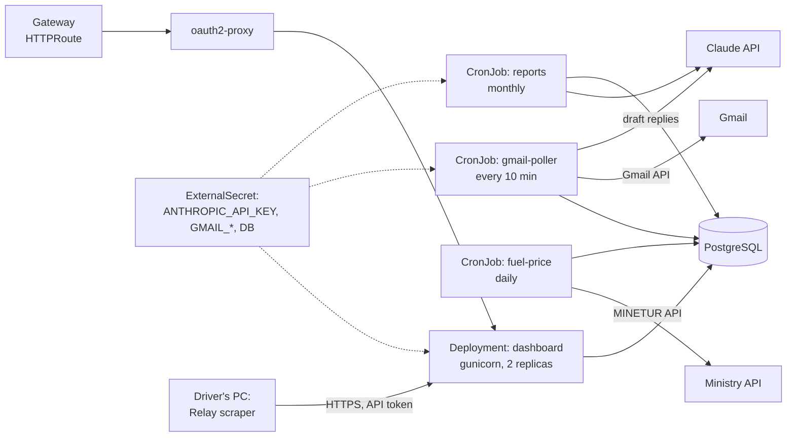
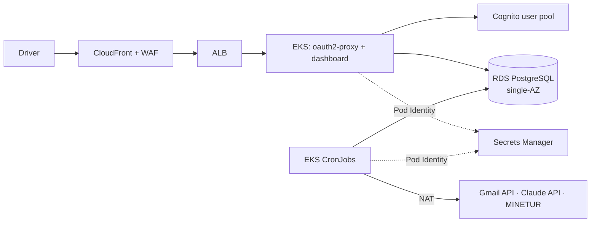
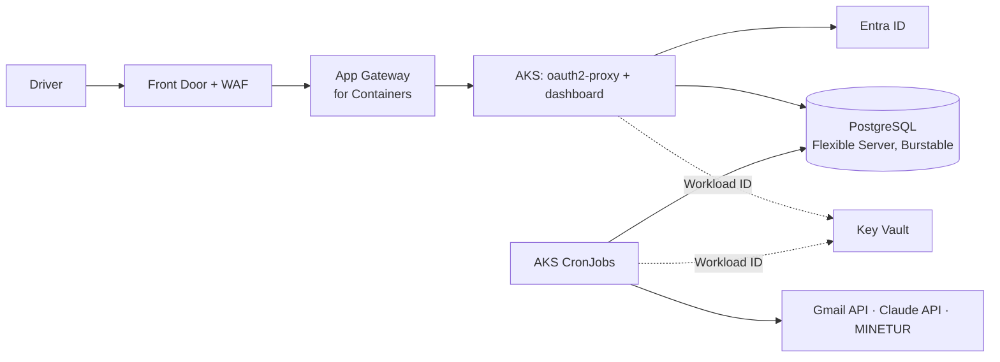

# Relay Traffic Copilot on AWS and Azure

Code: private repository.

## Today

- One Python process (`main.py`) that starts six threads: the Flask dashboard, a Gmail poller, a Playwright scraper for the Relay portal, a monthly report generator, a daily diesel price fetch from the Spanish Ministry API, and a keep-alive that moves the mouse with `pyautogui` so the desktop session stays awake.
- SQLite file next to the code. Configuration and credentials in `.env` and a Google OAuth `credentials.json`.
- The AI client is centralised in `agents/ai_client.py` (Claude Haiku by default).
- Hard rule: the AI never accepts, rejects or sends anything. A human approves every action in the dashboard.

## What changes in the cloud

The process becomes several workloads with one image. The keep-alive thread disappears, because it only exists to keep a Windows desktop awake.

| Thread today | In Kubernetes | Why |
|---|---|---|
| Flask dashboard | `Deployment` with gunicorn, 2 replicas | Stateless once the database moves out. |
| Gmail poller (every 10 min) | `CronJob` `*/10 * * * *` | One run per schedule, visible history of failures. Gmail push notifications through Pub/Sub would remove polling, at the cost of a Google Cloud dependency. |
| Diesel price (daily) | `CronJob` daily | Small, independent, retriable. |
| Monthly reports | `CronJob` monthly | Calls the AI client, writes to the database. |
| Relay portal scraper | **Stays on the driver's PC** (see risks) | Logging into the carrier portal from a datacenter IP with the driver's credentials is a security and terms-of-service risk. |
| Keep-alive | Removed | No desktop session in a container. |

Other changes:

- **SQLite to PostgreSQL** through the existing `database/models.py` layer, since several pods and CronJobs now write concurrently.
- **Credentials to the vault:** the Anthropic API key, the Gmail OAuth client and the refresh token move to Secrets Manager or Key Vault. The OAuth flow runs once locally to obtain the refresh token, which is then stored as a secret. Nothing credential-shaped stays in the image or the repository.
- **Authentication in front of the dashboard:** on a home PC the dashboard is only reachable on `localhost`. In the cloud it needs a login. `oauth2-proxy` in front of the Flask Service, backed by Amazon Cognito or Microsoft Entra ID, keeps the app code unchanged.

## Kubernetes topology

The scraper on the driver's PC posts its results to an authenticated endpoint on the dashboard instead of writing to a local SQLite file.

## AWS

- **Database:** RDS for PostgreSQL, single-AZ on a small instance: one user, low write volume, restore from backup is an acceptable recovery.
- **AI provider option:** the same models are available on Amazon Bedrock. Pointing `ai_client.py` at Bedrock removes the external API key, because the pod's IAM role authorises the call.

## Azure

- **Database:** PostgreSQL Flexible Server on the Burstable tier.
- **Identity:** Entra ID for the dashboard login. A single user, so the free tier covers it.

## Data migration

Export the SQLite tables to CSV, load them with `COPY` into PostgreSQL, compare row counts. Trip history and cost settings are the only data worth carrying over.

## Risks and open points

- **The scraper.** It reads the carrier's account on a third-party portal. Running it from cloud IPs can trigger the portal's fraud controls and may breach its terms. It stays on the driver's machine until there is an official integration.
- **Cost against value.** For one user, a shared cluster is the only way Kubernetes makes sense. Standalone, the right size is one container on ECS Fargate or Azure Container Apps with scheduled jobs (EventBridge Scheduler or Container Apps jobs).
- **The human-approval rule must survive the split.** Neither the CronJobs nor the AI client get credentials that can send email or accept a trip. Sending stays behind an explicit action in the dashboard.
