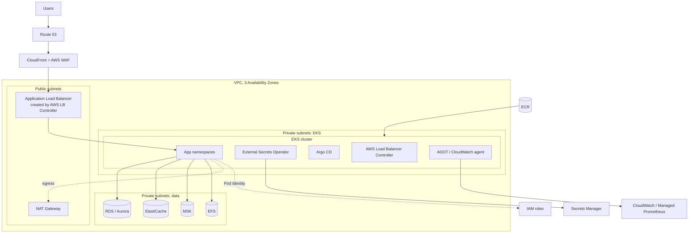
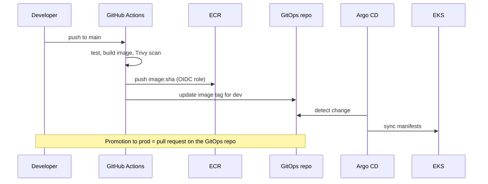

# AWS platform: EKS landing zone

The shared base every AWS playbook deploys onto. One VPC and one EKS cluster per environment (`dev`, `prod`), with managed data services in private subnets.

## Architecture



## Components

**Network.** A VPC across three Availability Zones with public subnets (load balancers, NAT) and two tiers of private subnets: one for nodes, one for data services. Security groups allow the data tier only from the node security group. VPC endpoints for ECR, S3, Secrets Manager and CloudWatch keep image pulls and secret reads off the NAT gateway.

**Cluster.** EKS with Auto Mode, which manages nodes, scaling and the core add-ons. Where Auto Mode is not available or more control is needed, managed node groups plus Karpenter. Nodes sit only in private subnets. The API endpoint is private, with public access restricted to the CI runners' range.

**Ingress.** The AWS Load Balancer Controller implements Gateway API. Each app defines an `HTTPRoute`. One shared ALB serves all apps by hostname. TLS terminates at CloudFront (ACM certificate in `us-east-1`) and again at the ALB (regional ACM certificate). AWS WAF managed rule groups run on CloudFront.

**Identity.** EKS Pod Identity maps each app's service account to an IAM role with least privilege (for example, only `secretsmanager:GetSecretValue` on `/<env>/<app>/*`).

**Secrets.** Secrets Manager is the source of truth. The External Secrets Operator syncs them into Kubernetes `Secret` objects scoped to the app's namespace, with a refresh interval so rotations propagate.

**Registry and supply chain.** ECR with scan on push and immutable tags. GitHub Actions authenticates to AWS through OIDC, so there are no long-lived access keys in CI.

**Observability.** CloudWatch Container Insights for cluster and pod metrics and logs. Application metrics through the AWS Distro for OpenTelemetry collector into Amazon Managed Service for Prometheus, dashboards in Amazon Managed Grafana.

**Backups.** Automated snapshots on RDS and Aurora with point-in-time recovery. AWS Backup policies for EFS.

## Infrastructure as code layout

```
infra/aws/
├── modules/
│   ├── network/        # VPC, subnets, NAT, VPC endpoints
│   ├── eks/            # cluster, Auto Mode or node groups, add-ons
│   ├── platform/       # LB Controller, External Secrets, Argo CD (Helm releases)
│   └── data/           # RDS, ElastiCache, MSK, EFS (one module each)
└── envs/
    ├── dev/main.tf
    └── prod/main.tf
```

## CI/CD flow


