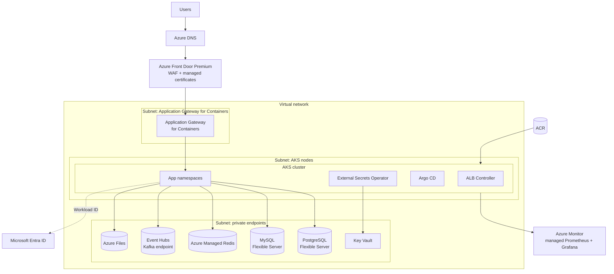

# Azure platform: AKS landing zone

The shared base every Azure playbook deploys onto. One virtual network and one AKS cluster per environment (`dev`, `prod`), with managed data services reached through private endpoints.

## Architecture



## Components

**Network.** A virtual network with dedicated subnets for the AKS nodes, for Application Gateway for Containers (delegated subnet) and for private endpoints. Data services have public access disabled and are reached only through private endpoints with private DNS zones linked to the VNet.

**Cluster.** AKS Automatic for a managed baseline (node autoprovisioning, upgrades, Azure CNI Overlay, workload identity and managed Prometheus enabled by default). AKS Standard with node autoprovisioning when more control is needed. The API server is private or restricted with authorised IP ranges.

**Ingress.** Application Gateway for Containers implements Gateway API through the ALB Controller. Each app defines an `HTTPRoute`. Azure Front Door Premium sits in front for global entry, WAF and managed certificates, and connects to the gateway.

**Identity.** Microsoft Entra Workload ID federates each app's Kubernetes service account with a user-assigned managed identity. Role assignments are per app (for example, `Key Vault Secrets User` on that app's secrets only).

**Secrets.** Key Vault is the source of truth. The External Secrets Operator syncs secrets into the app's namespace. The Key Vault Secrets Store CSI driver is a valid alternative when secrets should only exist as mounted files.

**Registry and supply chain.** Azure Container Registry, attached to the cluster so nodes pull without credentials. GitHub Actions authenticates with OIDC federated credentials on a managed identity, so CI holds no client secret.

**Observability.** Container Insights for logs, Azure Monitor managed service for Prometheus for metrics, Azure Managed Grafana for dashboards.

**Backups.** Built-in automated backups and point-in-time restore on the Flexible Servers. Azure Backup for Azure Files shares.

## Infrastructure as code layout

```
infra/azure/
├── modules/
│   ├── network/        # VNet, subnets, private DNS zones
│   ├── aks/            # cluster, node pools, add-ons
│   ├── platform/       # ALB Controller, External Secrets, Argo CD (Helm releases)
│   └── data/           # PostgreSQL, MySQL, Redis, Event Hubs, Storage (one module each)
└── envs/
    ├── dev/main.tf
    └── prod/main.tf
```

## Differences from AWS worth knowing

- Azure Database for MariaDB has been retired. MariaDB workloads move to Azure Database for MySQL Flexible Server.
- Azure Cache for Redis is being retired in favour of Azure Managed Redis, so new designs use Azure Managed Redis directly.
- Event Hubs speaks the Kafka protocol from the Standard tier up, but it is not a Kafka cluster: there are no brokers to manage, topics are event hubs created through Azure, and some Kafka features depend on the tier (check the compatibility page before relying on transactions or Kafka Streams). Apps that only produce and consume work unchanged.
